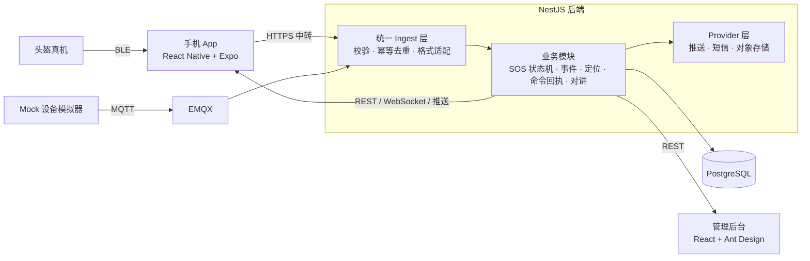
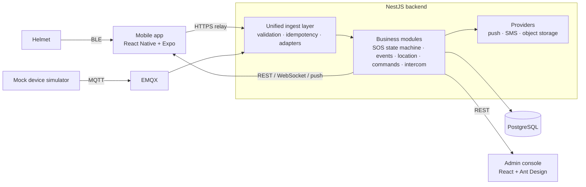

# 零一唯创 · AI 智能头盔软件系统

**[中文](#中文)** | **[English](#english)**

---

## 中文

AI 智能头盔的软件部分：手机 App（Android + iOS）、云端后端、管理后台。

头盔的传感器、摄像头、固件由硬件团队负责，摔倒判断和危险识别由算法团队负责。本系统只接收它们输出的结构化结果，完成后面的业务流程：保存、展示、通知、记录、查询。

> 私有仓库，深圳零一唯创科技有限公司内部项目，未开源。

### 功能

| 功能 | 说明 |
|---|---|
| 账号与设备 | 手机号注册（短信验证码）与密码登录、扫码或输入绑定码绑定头盔、在线状态 / 电量 / 固件版本 |
| 摔倒与 SOS | 头盔上报疑似摔倒或手动 SOS 后，服务端开始 60 秒倒计时；用户可取消或立即求助，到期未取消则自动推送并短信通知紧急联系人，全程留事故记录 |
| 危险事件 | 碰撞风险、障碍物风险的接收、实时提醒、历史查询与媒体关联 |
| 定位与轨迹 | 地图实时位置、历史轨迹回放、事故地点、位置分享、跳转第三方导航 |
| 设备设置 | 设置下发与回执跟踪，设备未确认执行前不显示成功 |
| 网络对讲 | 头盔作蓝牙耳机，语音经 App 走实时音视频云服务；频道、邀请码、成员管理 |
| 实时视频预览 | 手机连头盔热点看实时画面（开发中，见[当前状态](#当前状态2026-10-03)） |
| 管理后台 | 概览统计、用户、设备、事件、事故查询 |

### 架构

后端是模块化单体：REST、WebSocket、MQTT 消费都在同一个 NestJS 应用里，数据存单个 PostgreSQL。



几个关键设计：

- **数据链路**：MVP 阶段头盔不装 4G，事件经蓝牙发给手机 App，App 再通过 HTTPS 转交后端。4G 直连（MQTT）的全套代码已就绪，目前由 Mock 设备驱动，等硬件后续扩展。
- **统一接入**：无论事件来自蓝牙中转、MQTT 还是算法服务的 Webhook，都先进同一个 Ingest 层，按 `eventId` 去重后再交给业务模块。业务代码不知道也不关心事件来源。
- **SOS 以服务端为准**：倒计时截止时间存在数据库里，由后台周期扫描触发，不依赖内存定时器。App 被杀、手机断网、后端重启都不影响最终是否发出通知。
- **Mock 与真机同协议**：Mock 设备使用与真机完全相同的事件格式、Topic 和认证方式，换成真机时业务代码不用改。
- **近场 Wi-Fi**：头盔开热点、手机直连，只用于视频预览等近场功能，不传事件数据，也不经过云端。

### 仓库结构

```text
app/              手机 App（React Native + Expo，Android 与 iOS）
backend/          NestJS 后端（REST + WebSocket + MQTT 消费）
admin/            管理后台（React + Vite + Ant Design）
mock-device/      Mock 设备模拟器（与真机同协议）
packages/shared/  共享 TypeScript 类型：事件 Schema、API DTO、枚举
deploy/           云端部署编排（Docker Compose + Caddy + EMQX 模板）与托管的法律文档页
tools/            硬件到货前的自测工具：BLE 头盔仿真器、RTSP 测试视频流
docs/             接口约定、设备协议、决策记录、部署与演示手册
plan/             周计划、新成员上手指南、上线前总清单
```

### 技术栈

| 部分 | 选型 |
|---|---|
| App | React Native 0.86 + Expo SDK 57（Development Build，不用 Expo Go）、Expo Router、TanStack Query、Zustand |
| 后端 | NestJS 11、Prisma 7、PostgreSQL 16、EMQX 5 |
| 管理后台 | React 19、Vite 8、Ant Design 6 |
| 第三方服务 | 腾讯云（服务器、对象存储、短信、实时音视频 TRTC）、高德地图、极光推送 |
| 工程 | TypeScript 严格模式、npm workspaces（单一 lockfile）、Node 24、GitHub Actions |

### 快速开始

需要 Node 24（`.nvmrc` 已锁定）和 Docker。跑 App 还需要 Xcode 与 Android Studio。仓库路径不能含空格或中文，否则 iOS 构建会失败。

```bash
git clone https://github.com/Dragolone/AI-Smart-Helmet-01WeiChuang.git
cd AI-Smart-Helmet-01WeiChuang
nvm use
npm install                     # 只在根目录执行，一次装完所有子项目

docker compose up -d            # 本地 PostgreSQL + EMQX

cp backend/.env.example backend/.env    # 按文件内注释填写 DATABASE_URL 等
(cd backend && npx prisma migrate dev)  # 建表

npm run start:dev -w backend    # 后端
```

打开 <http://localhost:3000/api/v1/health>，返回 `{"status":"ok","database":"connected"}` 即后端正常。

接着让一台 Mock 头盔上线：

```bash
npm run provision:device -w backend     # 开通设备，输出 deviceId、密钥、绑定码（密钥只显示一次）
DEVICE_ID=<id> DEVICE_SECRET=<密钥> npm run start -w mock-device
```

Mock 默认跑骑行环路。加 `SCENARIO=fall`、`sos`、`risk` 或 `ski` 可切换到摔倒、手动 SOS、危险事件或滑雪剧本。

其余部分：

```bash
npm run dev -w admin                    # 管理后台（账号用 npm run create:admin -w backend 创建）
cd app && npx expo run:ios              # App 装到 iOS 模拟器或真机，首次构建约 10 分钟
cd app && npx expo run:android          # App 装到 Android
```

完整步骤、真机调试和已知问题见 [docs/DEVELOPMENT.md](docs/DEVELOPMENT.md)。

### 常用命令

均在仓库根目录执行。

| 目的 | 命令 |
|---|---|
| 类型检查 | `npm run typecheck --workspaces --if-present` |
| Lint | `npm run lint --workspaces --if-present` |
| 单元测试 | `npm test --workspaces --if-present` |
| 后端端到端测试 | `npm run test:e2e -w backend` |
| 修改 `packages/shared` 后重新构建 | `npm run build -w @helmet/shared` |

### 文档

| 文档 | 内容 |
|---|---|
| [CLAUDE.md](CLAUDE.md) | 项目全部开发约定：架构、规范、流程、双端要求。**开发前必读** |
| [docs/DECISIONS.md](docs/DECISIONS.md) | 已拍板的技术决策，不允许无理由推翻 |
| [docs/API.md](docs/API.md) | REST 与 WebSocket 接口约定 |
| [docs/EVENTS.md](docs/EVENTS.md) | 事件约定：头盔和算法传什么（字段、类型、单位、枚举） |
| [docs/DEVICE_PROTOCOL.md](docs/DEVICE_PROTOCOL.md) | 设备协议：怎么传（蓝牙、Wi-Fi、MQTT、认证） |
| [docs/DATABASE.md](docs/DATABASE.md) | 数据模型设计说明 |
| [docs/DEVELOPMENT.md](docs/DEVELOPMENT.md) | 本地环境、常用命令、平台限制清单 |
| [docs/DEPLOYMENT.md](docs/DEPLOYMENT.md) | 云端部署手册 |
| [docs/DEMO.md](docs/DEMO.md) | 演示脚本 |
| [docs/REGRESSION.md](docs/REGRESSION.md) | 双端回归清单 |
| [docs/THIRD_PARTY.md](docs/THIRD_PARTY.md) | 第三方账号与 Key 状态台账 |
| [plan/onboarding.md](plan/onboarding.md) | 新成员从零上手指南 |
| [plan/weekly-plan.md](plan/weekly-plan.md) | 12 周分工计划与进度 |
| [plan/LAUNCH_CHECKLIST.md](plan/LAUNCH_CHECKLIST.md) | 上线前总清单 |

### 当前状态（2026-10-03）

- **后端与管理后台**：主线功能全部完成并验收，云端 development 环境在线。
- **App**：注册登录、设备、地图轨迹、SOS、危险事件、设备设置、对讲在 Android 和 iOS 上均已实现；蓝牙中转模块已按硬件协议 v0.6 实现并用仿真器自测，等真头盔联调；实时视频预览在 PR #102，等双端真机测试。
- **上线前在办**：双端回归补测、短信签名、App 备案、软著、厂商推送通道、商店审核。
- **正式发布的硬门槛**：真头盔测通「摔倒 → 倒计时 → 通知」全链路，样机日期待硬件团队给出。

逐项进度以 [plan/LAUNCH_CHECKLIST.md](plan/LAUNCH_CHECKLIST.md) 为准。

### 协作约定

- 只有 `main` 和短命的功能分支（`feat/…`、`fix/…`、`docs/…`、`chore/…`），`main` 必须始终可运行。
- 每个改动走 PR，CI 通过后 Squash Merge；提交信息用 Conventional Commits。
- 修改 `packages/shared`、Prisma schema、`docs/` 下的约定文件或 CI 配置前先沟通。
- App 功能要 Android 真机和 iPhone 真机都通过才算完成。
- 任何密钥都不进 Git，`.env.example` 只放变量名。

---

## English

Software for an AI smart helmet: a mobile app (Android and iOS), a cloud backend, and an admin console.

The helmet's sensors, camera, and firmware belong to the hardware team; fall detection and hazard recognition belong to the algorithm team. This system receives their structured results and handles everything after that: storing, displaying, notifying, recording, and querying.

> Private repository. Internal project of Shenzhen Lingyi Weichuang Technology Co., Ltd. (深圳零一唯创科技有限公司). Not open source.

### Features

| Feature | Description |
|---|---|
| Accounts and devices | Sign-up by phone number with an SMS code, password login, helmet binding by QR code or binding code, online status, battery, and firmware version |
| Falls and SOS | When the helmet reports a possible fall or a manual SOS, the server starts a 60-second countdown. The rider can cancel or call for help immediately; if the countdown expires, emergency contacts are notified by push and SMS. Every incident is recorded |
| Hazard events | Collision and obstacle risks are received, shown in real time, kept in history, and linked to media |
| Location and tracks | Live position on a map, track playback, accident location, location sharing, and hand-off to third-party navigation apps |
| Device settings | Settings are sent as commands and tracked by acknowledgement; nothing shows as successful until the device confirms it |
| Network intercom | The helmet acts as a Bluetooth headset and voice goes through the app over a real-time communication service; channels, invite codes, and member management |
| Live video preview | The phone joins the helmet's Wi-Fi hotspot to view the camera (in progress, see [Status](#status-2026-10-03)) |
| Admin console | Overview statistics plus user, device, event, and accident lookup |

### Architecture

The backend is a modular monolith: REST, WebSocket, and MQTT consumption run in one NestJS application backed by a single PostgreSQL database.



Key design points:

- **Data link**: the MVP helmet has no 4G modem. Events travel over Bluetooth to the phone, and the app relays them to the backend over HTTPS. The direct 4G path (MQTT) is fully implemented and is currently driven by the mock device until the hardware adds 4G.
- **One ingest layer**: events from the Bluetooth relay, MQTT, or an algorithm-service webhook all pass through the same ingest layer and are de-duplicated by `eventId` before reaching business modules. Business code neither knows nor cares where an event came from.
- **The server owns the SOS countdown**: the deadline is stored in the database and fired by a periodic scan, not an in-memory timer. A killed app, a phone with no signal, or a backend restart does not change whether the notification goes out.
- **Mock and real devices speak the same protocol**: the mock device uses the same event format, topics, and authentication as a real helmet, so switching to real hardware needs no business-code changes.
- **Near-field Wi-Fi**: the helmet runs a hotspot and the phone connects to it directly. This is used only for near-field features such as video preview; it carries no event data and never touches the cloud.

### Repository layout

```text
app/              Mobile app (React Native + Expo, Android and iOS)
backend/          NestJS backend (REST + WebSocket + MQTT consumer)
admin/            Admin console (React + Vite + Ant Design)
mock-device/      Mock device simulator (same protocol as a real helmet)
packages/shared/  Shared TypeScript types: event schemas, API DTOs, enums
deploy/           Cloud deployment (Docker Compose + Caddy + EMQX template) and hosted legal pages
tools/            Test tools for working without hardware: BLE helmet simulator, RTSP test stream
docs/             API and event contracts, device protocol, decision log, deployment and demo guides
plan/             Weekly plan, onboarding guide, launch checklist
```

### Tech stack

| Area | Choices |
|---|---|
| App | React Native 0.86 + Expo SDK 57 (Development Build, not Expo Go), Expo Router, TanStack Query, Zustand |
| Backend | NestJS 11, Prisma 7, PostgreSQL 16, EMQX 5 |
| Admin console | React 19, Vite 8, Ant Design 6 |
| Third-party services | Tencent Cloud (servers, object storage, SMS, TRTC real-time audio), Amap (高德地图), JPush (极光推送) |
| Tooling | Strict TypeScript, npm workspaces with a single lockfile, Node 24, GitHub Actions |

### Getting started

You need Node 24 (pinned in `.nvmrc`) and Docker. Running the app also needs Xcode and Android Studio. Keep the repository in a path without spaces or non-ASCII characters, or the iOS build will fail.

```bash
git clone https://github.com/Dragolone/AI-Smart-Helmet-01WeiChuang.git
cd AI-Smart-Helmet-01WeiChuang
nvm use
npm install                     # run at the root only; installs every workspace

docker compose up -d            # local PostgreSQL + EMQX

cp backend/.env.example backend/.env    # fill in DATABASE_URL etc. as the comments describe
(cd backend && npx prisma migrate dev)  # create tables

npm run start:dev -w backend    # backend
```

Open <http://localhost:3000/api/v1/health>. A response of `{"status":"ok","database":"connected"}` means the backend is up.

Then bring a mock helmet online:

```bash
npm run provision:device -w backend     # prints deviceId, secret, and binding code (the secret is shown once)
DEVICE_ID=<id> DEVICE_SECRET=<secret> npm run start -w mock-device
```

The mock rides a loop by default. Set `SCENARIO=fall`, `sos`, `risk`, or `ski` to play the fall, manual SOS, hazard, or skiing script instead.

Everything else:

```bash
npm run dev -w admin                    # admin console (create an account with: npm run create:admin -w backend)
cd app && npx expo run:ios              # install the app on an iOS simulator or device; first build takes about 10 minutes
cd app && npx expo run:android          # install the app on Android
```

Full setup steps, on-device debugging, and known pitfalls are in [docs/DEVELOPMENT.md](docs/DEVELOPMENT.md).

### Common commands

Run all of these from the repository root.

| Purpose | Command |
|---|---|
| Type check | `npm run typecheck --workspaces --if-present` |
| Lint | `npm run lint --workspaces --if-present` |
| Unit tests | `npm test --workspaces --if-present` |
| Backend end-to-end tests | `npm run test:e2e -w backend` |
| Rebuild after editing `packages/shared` | `npm run build -w @helmet/shared` |

### Documentation

The documents are written in Chinese.

| Document | Contents |
|---|---|
| [CLAUDE.md](CLAUDE.md) | All project conventions: architecture, standards, workflow, dual-platform policy. **Read before developing** |
| [docs/DECISIONS.md](docs/DECISIONS.md) | Settled technical decisions; not to be reopened without new evidence |
| [docs/API.md](docs/API.md) | REST and WebSocket API contract |
| [docs/EVENTS.md](docs/EVENTS.md) | Event contract: what the helmet and algorithms send (fields, types, units, enums) |
| [docs/DEVICE_PROTOCOL.md](docs/DEVICE_PROTOCOL.md) | Device protocol: how it is sent (Bluetooth, Wi-Fi, MQTT, authentication) |
| [docs/DATABASE.md](docs/DATABASE.md) | Data model notes |
| [docs/DEVELOPMENT.md](docs/DEVELOPMENT.md) | Local setup, common commands, platform limitations |
| [docs/DEPLOYMENT.md](docs/DEPLOYMENT.md) | Cloud deployment guide |
| [docs/DEMO.md](docs/DEMO.md) | Demo script |
| [docs/REGRESSION.md](docs/REGRESSION.md) | Regression checklist for both platforms |
| [docs/THIRD_PARTY.md](docs/THIRD_PARTY.md) | Status of third-party accounts and keys |
| [plan/onboarding.md](plan/onboarding.md) | Onboarding guide for new team members |
| [plan/weekly-plan.md](plan/weekly-plan.md) | 12-week plan and progress |
| [plan/LAUNCH_CHECKLIST.md](plan/LAUNCH_CHECKLIST.md) | Launch checklist |

### Status (2026-10-03)

- **Backend and admin console**: all planned features are complete and accepted; the cloud development environment is live.
- **App**: sign-up and login, devices, map and tracks, SOS, hazard events, device settings, and intercom are implemented on both Android and iOS. The Bluetooth relay module is implemented against hardware protocol v0.6 and tested with the simulator; it is waiting for a real helmet. Live video preview is in PR #102, waiting for on-device testing on both platforms.
- **In progress before launch**: remaining regression runs on both platforms, SMS signature approval, app ICP filing, software copyright registration, vendor push channels, and store review.
- **Hard gate for release**: the fall → countdown → notification chain must pass end to end on a real helmet. The hardware team has not yet given a date for sample units.

[plan/LAUNCH_CHECKLIST.md](plan/LAUNCH_CHECKLIST.md) is the source of truth for item-by-item progress.

### Working agreements

- Only `main` and short-lived branches (`feat/…`, `fix/…`, `docs/…`, `chore/…`). `main` must always run.
- Every change goes through a pull request and is squash-merged after CI passes. Commit messages follow Conventional Commits.
- Talk to the other developer before changing `packages/shared`, the Prisma schema, contract files under `docs/`, or CI configuration.
- An app feature is done only when it works on both a physical Android phone and a physical iPhone.
- No secrets in Git. `.env.example` files contain variable names only.
