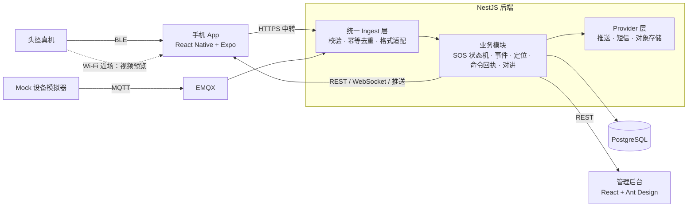
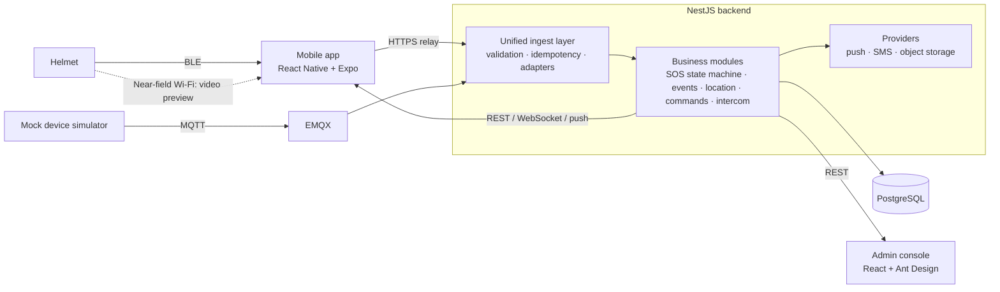

# 零一智行 · AI 智能头盔软件系统

**[中文](#中文)** | **[English](#english)**

---

## 中文

深圳零一唯创科技有限公司 AI 智能头盔的软件部分：手机 App「零一智行」（Android + iOS）、云端后端、管理后台。

头盔的传感器、摄像头、固件由硬件团队负责，摔倒判断和危险识别由算法团队负责。本系统只接收它们输出的结构化结果，完成后面的业务流程：保存、展示、通知、记录、查询。

> 仓库公开可见，但没有附带开源许可证，代码版权归深圳零一唯创科技有限公司所有。

### 功能

| 功能 | 说明 |
|---|---|
| 账号与设备 | 手机号注册（短信验证码）、密码登录与找回；扫码或输入绑定码绑定头盔，一个账号可绑多顶；在线状态 / 电量 / 固件版本 |
| 摔倒与 SOS | 头盔上报疑似摔倒或手动 SOS 后，服务端开始 60 秒倒计时；用户可在 App 里或直接在锁屏通知上取消，也可立即求助；到期未取消就推送并短信通知紧急联系人，全程留事故记录。多顶头盔同时求救时合在一张倒计时页里处理 |
| 危险事件 | 碰撞风险、障碍物风险的接收、实时提醒、历史查询与录像关联 |
| 定位与轨迹 | 地图实时位置、按「一趟」查看历史行程和轨迹回放、今日骑行统计、事故地点、位置分享、跳转第三方导航 |
| 蓝牙中转 | App 经蓝牙接收头盔事件并转交云端，退到后台或锁屏后继续中转；断线期间事件留在头盔里，重连后补传，不会重复建单 |
| 设备设置 | 设置下发与回执跟踪，头盔确认执行前不显示成功 |
| 网络对讲 | 头盔作蓝牙耳机，语音经 App 走腾讯云 TRTC；频道、邀请码、成员管理，对方掉线 15 秒内提示 |
| 实时视频预览 | 手机连头盔 Wi-Fi 热点看实时画面；已用测试视频流在双端跑通，等真头盔 |
| 管理后台 | 概览统计、用户、设备（含详情）、事件、事故查询 |
| 界面 | 简体中文、繁体中文、英文；浅色与深色 |

### 架构

后端是模块化单体：REST、WebSocket、MQTT 消费都在同一个 NestJS 应用里，数据存单个 PostgreSQL。



几个关键设计：

- **数据链路**：MVP 阶段头盔不装 4G，事件经蓝牙发给手机 App，App 再通过 HTTPS 转交后端。4G 直连（MQTT）的全套代码已就绪，目前由 Mock 设备驱动，等硬件后续扩展。Mock 设备也能改走蓝牙版的中转入口（`TRANSPORT=app-relay`）。
- **统一接入**：无论事件来自蓝牙中转、MQTT 还是算法服务的 Webhook，都先进同一个 Ingest 层，按 `deviceId + eventId` 去重后再交给业务模块。业务代码不知道也不关心事件来源。
- **SOS 以服务端为准**：倒计时截止时间存在数据库里，由后台周期扫描触发，不依赖内存定时器。App 被杀、手机断网、后端重启都不影响最终是否发出通知。
- **Mock 与真机同协议**：Mock 设备使用与真机完全相同的事件格式、Topic 和认证方式，换成真机时业务代码不用改。
- **近场 Wi-Fi**：头盔开热点、手机直连，只用于视频预览等近场功能，不传事件数据，也不经过云端。

### 仓库结构

```text
app/              手机 App（React Native + Expo，Android 与 iOS）
backend/          NestJS 后端（REST + WebSocket + MQTT 消费）
admin/            管理后台（React + Vite + Ant Design）
mock-device/      Mock 设备模拟器（与真机同协议，可走 MQTT 或蓝牙版中转入口）
packages/shared/  共享 TypeScript 类型：事件 Schema、API DTO、枚举
deploy/           云端部署编排（Docker Compose + Caddy + EMQX 模板）与托管的法律文档页
emqx/             本地 EMQX 配置
patches/          第三方原生库补丁（patch-package，npm install 时自动打上）
tools/            硬件到货前的自测工具：BLE 头盔仿真器、RTSP 测试视频流
design/           设计素材（头盔图、界面参考）与抠图脚本
docs/             接口约定、设备协议、决策记录、部署与演示手册、测试记录
plan/             周计划、新成员上手指南、上线前总清单、上线后优化清单
```

### 技术栈

| 部分 | 选型 |
|---|---|
| App | React Native 0.86 + Expo SDK 57（Development Build，不用 Expo Go）、Expo Router、TanStack Query、Zustand、react-native-ble-plx（蓝牙）、libVLC（视频预览） |
| 后端 | NestJS 11、Prisma 7、PostgreSQL 16、EMQX 5、原生 WebSocket（ws） |
| 管理后台 | React 19、Vite 8、Ant Design 6、TanStack Query |
| 第三方服务 | 腾讯云（服务器、对象存储 COS、短信、实时音视频 TRTC）、高德地图（WebView + JS API）、极光推送（含华为、小米厂商通道） |
| 测试 | Jest + supertest（后端、App）、Vitest（管理后台）、Node 内置 test runner（Mock 设备、shared） |
| 工程 | TypeScript 严格模式、npm workspaces（单一 lockfile）、Node 24、GitHub Actions |

### 快速开始

需要 Node 24（`.nvmrc` 已锁定）和 Docker。跑 App 还需要 Xcode 与 Android Studio。仓库路径不能含空格或中文，否则 iOS 构建会失败。

```bash
git clone https://github.com/Dragolone/AI-Smart-Helmet-01WeiChuang.git
cd AI-Smart-Helmet-01WeiChuang
nvm use
npm install                     # 只在根目录执行，一次装完所有子项目并打上 patches/ 里的补丁

docker compose up -d            # 本地 PostgreSQL + EMQX

cp backend/.env.example backend/.env    # 按文件内注释填写 DATABASE_URL 等
(cd backend && npx prisma migrate dev)  # 建表

npm run start:dev -w backend    # 后端
```

打开 <http://localhost:3000/api/v1/health>，返回 `{"status":"ok","database":"connected"}` 即后端正常。

接着让一台 Mock 头盔上线：

```bash
npm run provision:device -w backend     # 开通设备，输出 deviceId、密钥、绑定码（密钥只显示一次）
DEVICE_ID=<id> DEVICE_SECRET=<密钥> npm run start -w mock-device
```

Mock 默认跑骑行环路。加 `SCENARIO=fall`、`sos`、`risk`、`ski` 可切换到摔倒、手动 SOS、危险事件、滑雪剧本；`SCENARIO=tour` 一轮把所有情况轮一遍（8 条危险事件、摔倒、休眠唤醒、蓝牙断开）。

要模拟蓝牙版（App 中转），先在 App 里把这台设备绑到自己账号，再用中转模式启动：

```bash
TRANSPORT=app-relay API_BASE_URL=http://localhost:3000 RELAY_PHONE=<手机号> RELAY_PASSWORD=<密码> DEVICE_ID=<id> npm run start -w mock-device
```

其余部分：

```bash
npm run dev -w admin                    # 管理后台（账号用 npm run create:admin -w backend 创建）

cp app/.env.example app/.env            # 真机调试时 EXPO_PUBLIC_API_URL 填电脑的局域网 IP；高德 Key 见文件内注释
cd app && npx expo run:ios              # App 装到 iOS 模拟器或真机，首次构建约 10 分钟
cd app && npx expo run:android          # App 装到 Android
```

没有头盔时，可以用 `tools/ble-helmet-sim/helmet_sim.py` 让 Mac 扮演蓝牙头盔（真机测蓝牙中转），用 `tools/rtsp-mock/start_rtsp.sh` 在电脑上起一路测试视频流（测视频预览）。

完整步骤、真机调试和已知问题见 [docs/DEVELOPMENT.md](docs/DEVELOPMENT.md)。

### 常用命令

均在仓库根目录执行。

| 目的 | 命令 |
|---|---|
| 类型检查 | `npm run typecheck --workspaces --if-present` |
| Lint | `npm run lint --workspaces --if-present` |
| 单元测试 | `npm test --workspaces --if-present` |
| 后端端到端测试 | `npm run test:e2e -w backend` |
| 修改 `packages/shared` 后重新构建 | `npm run build -w @helmet/shared` |
| 拉完 main 后同步本机数据库 | `(cd backend && npx prisma migrate deploy)` |

### 文档

| 文档 | 内容 |
|---|---|
| [CLAUDE.md](CLAUDE.md) | 项目全部开发约定：架构、规范、流程、双端要求。**开发前必读** |
| [docs/DECISIONS.md](docs/DECISIONS.md) | 已拍板的技术决策，不允许无理由推翻 |
| [docs/API.md](docs/API.md) | REST 与 WebSocket 接口约定 |
| [docs/EVENTS.md](docs/EVENTS.md) | 事件约定：头盔和算法传什么（字段、类型、单位、枚举） |
| [docs/DEVICE_PROTOCOL.md](docs/DEVICE_PROTOCOL.md) | 设备协议：怎么传（蓝牙、Wi-Fi、MQTT、认证），含待硬件确认清单 |
| [docs/hardware/](docs/hardware/) | 硬件团队提供的原始协议文件（BLE 通信协议手册 v0.6 等） |
| [docs/BLE_BENCH.md](docs/BLE_BENCH.md) | 蓝牙工程模式联调测试清单（与硬件对表用） |
| [docs/DATABASE.md](docs/DATABASE.md) | 数据模型设计说明 |
| [docs/DEVELOPMENT.md](docs/DEVELOPMENT.md) | 本地环境、常用命令、平台限制清单 |
| [docs/DEPLOYMENT.md](docs/DEPLOYMENT.md) | 云端部署手册（含转正式环境的切换步骤） |
| [docs/DEMO.md](docs/DEMO.md) | 演示脚本 |
| [docs/REGRESSION.md](docs/REGRESSION.md) | 双端回归清单 |
| [docs/testing/](docs/testing/) | 历次全面测试与评审记录，以及需要负责人本人动手的手测清单 |
| [docs/THIRD_PARTY.md](docs/THIRD_PARTY.md) | 第三方账号与 Key 状态台账 |
| [docs/STORE_LISTING.md](docs/STORE_LISTING.md) | 应用商店上架与 App 备案材料 |
| [plan/onboarding.md](plan/onboarding.md) | 新成员从零上手指南 |
| [plan/weekly-plan.md](plan/weekly-plan.md) | 12 周分工计划与进度 |
| [plan/LAUNCH_CHECKLIST.md](plan/LAUNCH_CHECKLIST.md) | 上线前总清单 |
| [plan/OPTIMIZATIONS.md](plan/OPTIMIZATIONS.md) | 不卡上线、上线后再做的改进 |

### 当前状态（2026-10-26）

- **后端与管理后台**：主线功能全部完成并验收，云端 development 环境在线。正式环境沿用同一台服务器，换用新域名，切换日待定。
- **App**：MVP 功能在 Android 和 iOS 上均已实现，实时视频预览已于 10-14 合入。蓝牙中转按硬件协议 v0.6 实现，用 Mac 仿真头盔在华为和 iPhone 真机上验证过后台、锁屏下的实时中转。目前在做双端回归和评审问题修复。
- **上架**：等 App 备案号（预计 11 月下旬至 12 月中旬），拿到后 App Store 与安卓各商店同时提审；软著、短信套餐、商店材料同期推进。
- **正式发布的硬门槛**：真头盔测通「摔倒 → 倒计时 → 通知」全链路，样机日期待硬件团队给出。
- **排在 MVP 之后**：TF 卡视频读取、休眠与防丢、4G 版头盔、iOS 紧急提醒（Critical Alerts，等苹果审批）。

逐项进度以 [plan/LAUNCH_CHECKLIST.md](plan/LAUNCH_CHECKLIST.md) 为准。

### 协作约定

- 只有 `main` 和短命的功能分支（`feat/…`、`fix/…`、`docs/…`、`chore/…`），`main` 必须始终可运行。
- 每个改动走 PR，CI 通过后 Squash Merge；提交信息用 Conventional Commits。
- 修改 `packages/shared`、Prisma schema、`docs/` 下的约定文件或 CI 配置前先沟通。
- App 功能要 Android 真机和 iPhone 真机都通过才算完成。
- 任何密钥都不进 Git，`.env.example` 只放变量名。

---

## English

Software for the AI smart helmet by Shenzhen Lingyi Weichuang Technology Co., Ltd. (深圳零一唯创科技有限公司): the 零一智行 mobile app (Android and iOS), a cloud backend, and an admin console.

The helmet's sensors, camera, and firmware belong to the hardware team; fall detection and hazard recognition belong to the algorithm team. This system receives their structured results and handles everything after that: storing, displaying, notifying, recording, and querying.

> This repository is publicly visible but carries no open-source license. The code is copyrighted by Shenzhen Lingyi Weichuang Technology Co., Ltd.

### Features

| Feature | Description |
|---|---|
| Accounts and devices | Sign-up by phone number with an SMS code, password login and reset; helmet binding by QR code or binding code, several helmets per account; online status, battery, and firmware version |
| Falls and SOS | When the helmet reports a possible fall or a manual SOS, the server starts a 60-second countdown. The rider can cancel in the app or straight from the lock-screen notification, or call for help immediately; if the countdown expires, emergency contacts are notified by push and SMS. Every incident is recorded. When several helmets raise SOS at once, they are handled on a single countdown screen |
| Hazard events | Collision and obstacle risks are received, shown in real time, kept in history, and linked to video clips |
| Location and tracks | Live position on a map, past rides with track playback, today's riding summary, accident location, location sharing, and hand-off to third-party navigation apps |
| Bluetooth relay | The app receives helmet events over Bluetooth and forwards them to the cloud, and keeps doing so in the background and on the lock screen. Events raised while disconnected stay on the helmet and are uploaded after reconnecting, without creating duplicate incidents |
| Device settings | Settings are sent as commands and tracked by acknowledgement; nothing shows as successful until the helmet confirms it |
| Network intercom | The helmet acts as a Bluetooth headset and voice goes through the app over Tencent Cloud TRTC; channels, invite codes, and member management, with a notice within 15 seconds when someone drops out |
| Live video preview | The phone joins the helmet's Wi-Fi hotspot to view the camera. Verified on both platforms with a test stream; waiting for a real helmet |
| Admin console | Overview statistics plus user, device (with detail page), event, and accident lookup |
| Interface | Simplified Chinese, Traditional Chinese, and English; light and dark themes |

### Architecture

The backend is a modular monolith: REST, WebSocket, and MQTT consumption run in one NestJS application backed by a single PostgreSQL database.



Key design points:

- **Data link**: the MVP helmet has no 4G modem. Events travel over Bluetooth to the phone, and the app relays them to the backend over HTTPS. The direct 4G path (MQTT) is fully implemented and is currently driven by the mock device until the hardware adds 4G. The mock device can also use the Bluetooth version's relay endpoint (`TRANSPORT=app-relay`).
- **One ingest layer**: events from the Bluetooth relay, MQTT, or an algorithm-service webhook all pass through the same ingest layer and are de-duplicated by `deviceId + eventId` before reaching business modules. Business code neither knows nor cares where an event came from.
- **The server owns the SOS countdown**: the deadline is stored in the database and fired by a periodic scan, not an in-memory timer. A killed app, a phone with no signal, or a backend restart does not change whether the notification goes out.
- **Mock and real devices speak the same protocol**: the mock device uses the same event format, topics, and authentication as a real helmet, so switching to real hardware needs no business-code changes.
- **Near-field Wi-Fi**: the helmet runs a hotspot and the phone connects to it directly. This is used only for near-field features such as video preview; it carries no event data and never touches the cloud.

### Repository layout

```text
app/              Mobile app (React Native + Expo, Android and iOS)
backend/          NestJS backend (REST + WebSocket + MQTT consumer)
admin/            Admin console (React + Vite + Ant Design)
mock-device/      Mock device simulator (same protocol as a real helmet; MQTT or the Bluetooth relay endpoint)
packages/shared/  Shared TypeScript types: event schemas, API DTOs, enums
deploy/           Cloud deployment (Docker Compose + Caddy + EMQX template) and hosted legal pages
emqx/             Local EMQX configuration
patches/          Patches for third-party native libraries (patch-package, applied on npm install)
tools/            Test tools for working without hardware: BLE helmet simulator, RTSP test stream
design/           Design assets (helmet images, UI references) and a background-removal script
docs/             API and event contracts, device protocol, decision log, deployment and demo guides, test records
plan/             Weekly plan, onboarding guide, launch checklist, post-launch improvements
```

### Tech stack

| Area | Choices |
|---|---|
| App | React Native 0.86 + Expo SDK 57 (Development Build, not Expo Go), Expo Router, TanStack Query, Zustand, react-native-ble-plx (Bluetooth), libVLC (video preview) |
| Backend | NestJS 11, Prisma 7, PostgreSQL 16, EMQX 5, plain WebSocket (ws) |
| Admin console | React 19, Vite 8, Ant Design 6, TanStack Query |
| Third-party services | Tencent Cloud (servers, COS object storage, SMS, TRTC real-time audio), Amap (高德地图, WebView + JS API), JPush (极光推送, with Huawei and Xiaomi vendor channels) |
| Testing | Jest + supertest (backend, app), Vitest (admin console), Node's built-in test runner (mock device, shared) |
| Tooling | Strict TypeScript, npm workspaces with a single lockfile, Node 24, GitHub Actions |

### Getting started

You need Node 24 (pinned in `.nvmrc`) and Docker. Running the app also needs Xcode and Android Studio. Keep the repository in a path without spaces or non-ASCII characters, or the iOS build will fail.

```bash
git clone https://github.com/Dragolone/AI-Smart-Helmet-01WeiChuang.git
cd AI-Smart-Helmet-01WeiChuang
nvm use
npm install                     # run at the root only; installs every workspace and applies the patches in patches/

docker compose up -d            # local PostgreSQL + EMQX

cp backend/.env.example backend/.env    # fill in DATABASE_URL etc. as the comments describe
(cd backend && npx prisma migrate dev)  # create tables

npm run start:dev -w backend    # backend
```

Open <http://localhost:3000/api/v1/health>. A response of `{"status":"ok","database":"connected"}` means the backend is up.

Then bring a mock helmet online:

```bash
npm run provision:device -w backend     # prints deviceId, secret, and binding code (the secret is shown once)
DEVICE_ID=<id> DEVICE_SECRET=<secret> npm run start -w mock-device
```

The mock rides a loop by default. Set `SCENARIO=fall`, `sos`, `risk`, or `ski` to play the fall, manual SOS, hazard, or skiing script instead; `SCENARIO=tour` cycles through every case in one round (eight hazard events, a fall, sleep and wake, a Bluetooth disconnect).

To simulate the Bluetooth version (relay through the app), first bind the device to your account in the app, then start the mock in relay mode:

```bash
TRANSPORT=app-relay API_BASE_URL=http://localhost:3000 RELAY_PHONE=<phone> RELAY_PASSWORD=<password> DEVICE_ID=<id> npm run start -w mock-device
```

Everything else:

```bash
npm run dev -w admin                    # admin console (create an account with: npm run create:admin -w backend)

cp app/.env.example app/.env            # on a physical phone, set EXPO_PUBLIC_API_URL to your computer's LAN IP; see the comments for Amap keys
cd app && npx expo run:ios              # install the app on an iOS simulator or device; first build takes about 10 minutes
cd app && npx expo run:android          # install the app on Android
```

Without a helmet, `tools/ble-helmet-sim/helmet_sim.py` lets a Mac act as a Bluetooth helmet (for testing the relay on a physical phone), and `tools/rtsp-mock/start_rtsp.sh` serves a test video stream from your computer (for testing video preview).

Full setup steps, on-device debugging, and known pitfalls are in [docs/DEVELOPMENT.md](docs/DEVELOPMENT.md).

### Common commands

Run all of these from the repository root.

| Purpose | Command |
|---|---|
| Type check | `npm run typecheck --workspaces --if-present` |
| Lint | `npm run lint --workspaces --if-present` |
| Unit tests | `npm test --workspaces --if-present` |
| Backend end-to-end tests | `npm run test:e2e -w backend` |
| Rebuild after editing `packages/shared` | `npm run build -w @helmet/shared` |
| Bring your local database up to date after pulling main | `(cd backend && npx prisma migrate deploy)` |

### Documentation

The documents are written in Chinese.

| Document | Contents |
|---|---|
| [CLAUDE.md](CLAUDE.md) | All project conventions: architecture, standards, workflow, dual-platform policy. **Read before developing** |
| [docs/DECISIONS.md](docs/DECISIONS.md) | Settled technical decisions; not to be reopened without new evidence |
| [docs/API.md](docs/API.md) | REST and WebSocket API contract |
| [docs/EVENTS.md](docs/EVENTS.md) | Event contract: what the helmet and algorithms send (fields, types, units, enums) |
| [docs/DEVICE_PROTOCOL.md](docs/DEVICE_PROTOCOL.md) | Device protocol: how it is sent (Bluetooth, Wi-Fi, MQTT, authentication), including open questions for the hardware team |
| [docs/hardware/](docs/hardware/) | Original protocol files from the hardware team (BLE protocol manual v0.6 and others) |
| [docs/BLE_BENCH.md](docs/BLE_BENCH.md) | Bluetooth engineering-mode test checklist, shared with the hardware team |
| [docs/DATABASE.md](docs/DATABASE.md) | Data model notes |
| [docs/DEVELOPMENT.md](docs/DEVELOPMENT.md) | Local setup, common commands, platform limitations |
| [docs/DEPLOYMENT.md](docs/DEPLOYMENT.md) | Cloud deployment guide, including the production cutover steps |
| [docs/DEMO.md](docs/DEMO.md) | Demo script |
| [docs/REGRESSION.md](docs/REGRESSION.md) | Regression checklist for both platforms |
| [docs/testing/](docs/testing/) | Records of each full test and review round, plus the manual checks the project owner runs in person |
| [docs/THIRD_PARTY.md](docs/THIRD_PARTY.md) | Status of third-party accounts and keys |
| [docs/STORE_LISTING.md](docs/STORE_LISTING.md) | App store listing and app ICP filing materials |
| [plan/onboarding.md](plan/onboarding.md) | Onboarding guide for new team members |
| [plan/weekly-plan.md](plan/weekly-plan.md) | 12-week plan and progress |
| [plan/LAUNCH_CHECKLIST.md](plan/LAUNCH_CHECKLIST.md) | Launch checklist |
| [plan/OPTIMIZATIONS.md](plan/OPTIMIZATIONS.md) | Improvements that do not block launch |

### Status (2026-10-26)

- **Backend and admin console**: all planned features are complete and accepted; the cloud development environment is live. Production will reuse the same server under new domain names; the cutover date is not set yet.
- **App**: MVP features are implemented on both Android and iOS, and live video preview was merged on 10-14. The Bluetooth relay is implemented against hardware protocol v0.6 and has been verified on a physical Huawei phone and iPhone against a Mac helmet simulator, including real-time relay in the background and on the lock screen. Current work is regression on both platforms and fixes from code review.
- **Store release**: waiting for the app ICP filing number (expected late November to mid-December); the App Store and the Android stores will be submitted together once it arrives. Software copyright registration, SMS packages, and store materials are progressing in parallel.
- **Hard gate for release**: the fall → countdown → notification chain must pass end to end on a real helmet. The hardware team has not yet given a date for sample units.
- **After the MVP**: reading video from the helmet's TF card, sleep and anti-loss alerts, a 4G helmet, and iOS Critical Alerts (awaiting Apple's approval).

[plan/LAUNCH_CHECKLIST.md](plan/LAUNCH_CHECKLIST.md) is the source of truth for item-by-item progress.

### Working agreements

- Only `main` and short-lived branches (`feat/…`, `fix/…`, `docs/…`, `chore/…`). `main` must always run.
- Every change goes through a pull request and is squash-merged after CI passes. Commit messages follow Conventional Commits.
- Talk to the other developer before changing `packages/shared`, the Prisma schema, contract files under `docs/`, or CI configuration.
- An app feature is done only when it works on both a physical Android phone and a physical iPhone.
- No secrets in Git. `.env.example` files contain variable names only.
